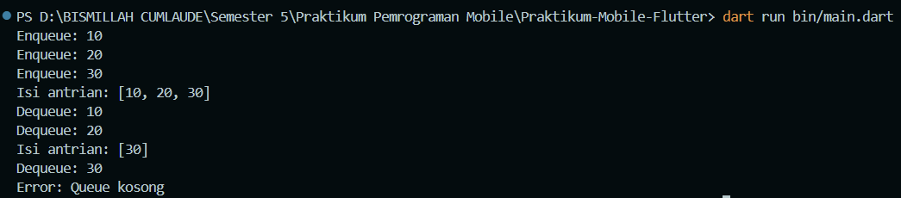
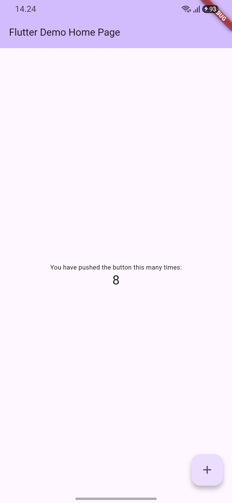
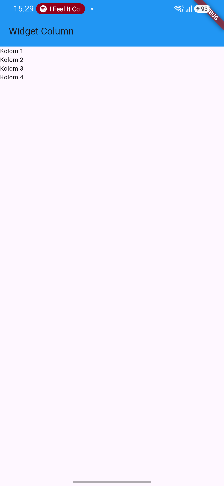
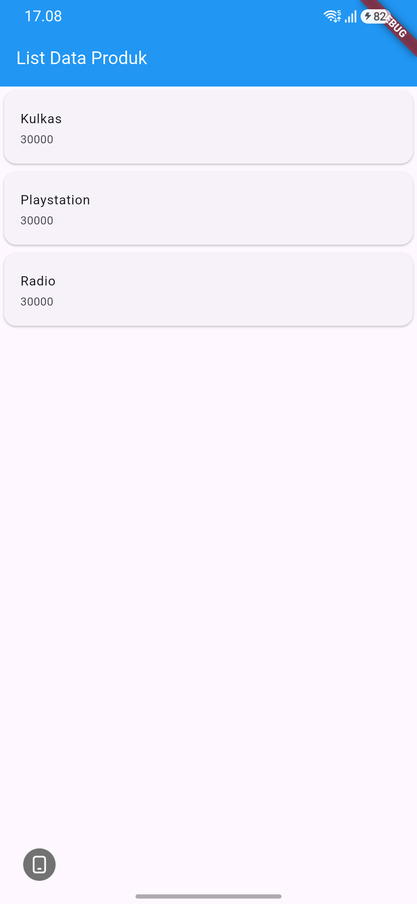

# H1D024016-Praktikum-Mobile-Flutter
Nama : Zahratul Askia
NIM  : H1D024016

## Modul 1 - Bahasa Pemrograman Dart

Implementasi Queue (FIFO) dengan method `enqueue()` dan `dequeue()`.

- `lib/queue.dart` : class Queue
- `bin/main.dart`  : program utama untuk mencoba Queue

Cara menjalankan:
dart run bin/main.dart

### Hasil Output

## Modul 2 - Pengenalan dan Desain Framework Flutter

Aplikasi Flutter berisi latihan dasar widget dan desain antarmuka (Material Design).
Proyeknya ada di folder `modul2/`.

- `modul2/lib/main.dart`             : program utama, memanggil halaman lewat `home:`
- `modul2/lib/hello_world.dart`      : halaman Hello World
- `modul2/lib/column_widget.dart`    : widget `Column` (vertikal)
- `modul2/lib/row_widget.dart`       : widget `Row` (horizontal)
- `modul2/lib/ui/produk_form.dart`   : form input produk
- `modul2/lib/ui/produk_detail.dart` : halaman detail produk
- `modul2/lib/ui/produk_page.dart`   : daftar produk dengan `ListView`

Cara menjalankan:
cd modul2
flutter pub get
flutter run

Untuk mengganti halaman yang ditampilkan, ubah `home:` pada `modul2/lib/main.dart`.

### Hasil Output

**Proyek Pertama (template bawaan Flutter)**

**Widget Column**

**List Data Produk**

