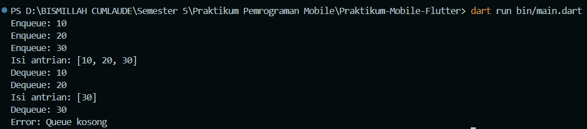

# H1D024016-Praktikum-Mobile-Flutter
Nama : Zahratul Askia
NIM  : H1D024016

## Modul 1 - Bahasa Pemrograman Dart

Implementasi Queue (FIFO) dengan method `enqueue()` dan `dequeue()`.

- `queue.dart` : class Queue
- `main.dart`  : program utama untuk mencoba Queue

Cara menjalankan:
dart run main.dart

### Hasil Output

   